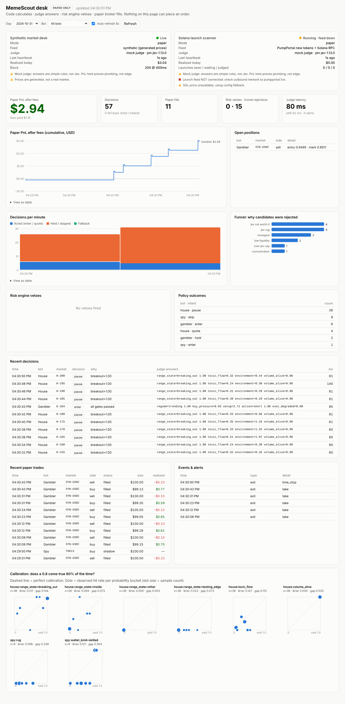

# MemeScout desk: paper-only AI trading desk skeleton

**Code calculates. Jev judges. The risk engine vetoes. The paper broker executes. You sign anything irreversible.**

There is no live broker in this repo. `broker/interface.js#createLiveBroker` throws.

```
feed → state/ (code: mid, spread, imbalance, vol, returns, inventory, drawdown)
     → judge/ (one call per decision, whole battery, raw typed answers)
     → policy/ (thresholds + weights from config/desk.json)
     → risk/  (hard vetoes, no model vote)
     → broker/paper.js   (paper mode)   |  nothing (shadow mode)
     → logs/  (state, questions, answers, outcomes → reports/)
```

## Quick start (no keys, no network)

```bash
cd desk
npm test                                   # 30 tests
DESK_TICKS=500 npm run shadow              # Jev labels everything, nothing executes
DESK_TICKS=500 npm run paper               # policy executes against the paper broker
npm run report:daily                       # decisions, trades, PnL after fees, vetoes, fallbacks
npm run report:calibration                 # Brier, ECE, Platt fit, reliability SVGs → logs/data/reports/
```

Without `JUDGE_URL`, the runner uses an in-process **mock** judge. It's a set of deterministic heuristics, not a model, so the whole loop and the reports can run. Calibration numbers from the mock mean nothing.

### Running the judge as its own service

```bash
export DESK_SECRET=$(node -e "console.log(require('crypto').randomBytes(32).toString('hex'))")
JEV_MOCK=1 npm run judge                   # holds the Jev key; bots never see it
JUDGE_URL=http://127.0.0.1:8787 npm run shadow
```

Test the link from the bot's own host, not your laptop.

## Dashboard

```bash
npm run dashboard        # http://127.0.0.1:8080, refreshes every 5 s
```

Run it alongside `npm run paper` and/or `npm run solana`. It reads the logs and never writes or trades. It shows:
- runner health: live / stale / down, feed connected, mock vs real judge
- paper PnL after fees by bot, plus decisions per minute
- open positions, the funnel's rejection reasons, risk vetoes, recent decisions with every judge answer, trades, events
- calibration charts per question

Each chart has a table view, and the page follows the system light/dark setting. It binds to localhost. To expose it (e.g. as a Render web service), set `DASHBOARD_HOST=0.0.0.0` and a `DASHBOARD_TOKEN` of 24+ characters, then open `/?token=…`.



## Live Solana launches (Spy, paper)

```bash
npm run solana          # paper: real pump.fun launches, simulated fills on the real bonding curve
npm run solana:shadow   # same pipeline, logs what it would buy, no fills
```

What it does, in order:
1. **Feed:** PumpPortal `subscribeNewToken` only, the same free creation stream the root worker uses. No metered trade subscriptions.
2. **Wait:** each launch waits 45 s (too young to judge before that). After 5 min it expires and is never replayed.
3. **Free cut** on event data: creator's initial buy over 10% of supply → rejected.
4. **Enrich:** 3 read-only Solana RPC calls (mint account, bonding curve, top holders).
5. **Hard facts in code:** mint authority open, freeze authority open, curve graduated, market cap under $6k, under 2 SOL of net inflow, top 10 holders (excluding the curve) over 35%, any single holder over 10%.
6. **Jev** on the best 3 survivors (`questions/launch.js`). Token name, symbol and URI are attacker-controlled text, so they are **never** put in the state.
7. **Policy → risk engine → paper fill** at the exact constant-product price, including the 1.25% fee and $0.10 gas per side.
8. **EXIT seat** polls the curve every 5 s: +30% take, −15% stop, 10 min time stop, graduated, or no data after 2 retries → close.
9. **Outcomes:** for every judged launch, `momentum` is checked against the price 2 min later and `rug` against a 50% drop within 10 min. These feed `report:calibration`.

One position at a time: the scan is off while a position is open. Every number is under `solana` in `config/desk.json`.

### Two ledgers: optimistic vs pessimistic

Every Solana paper trade is booked twice:

| ledger | how it fills |
|---|---|
| **optimistic** (ceiling) | instantly, at the curve price just read |
| **pessimistic** (closer to a floor) | waits 1.5 s and re-reads the curve; a sniper buys 0.5 SOL ahead of you; +3% slippage each way; 0.001 SOL priority fee per transaction; 15% of transactions fail (fee still paid, exits retry); an exit that fails 3 times is written off at zero |

The headline PnL, the daily loss limit and the risk engine all use the **pessimistic** ledger. The optimistic one is shown on the dashboard as a dashed "ceiling" line. Tune it under `solana.pessimistic`.

### Spot-check (automatic)

Each paper fill gets checked 60 s later. The desk fetches real on-chain trades on the same bonding curve within ±15 s and compares prices. **Flattery** = how much better the paper fill was than what real traders got. The optimistic ledger will flatter you. If the pessimistic ledger also flatters you on a large share of fills, it isn't pessimistic enough, so raise `front_run_sol` / `extra_slippage_bps`. Results go to `logs/data/spotchecks-*.jsonl` and to the dashboard.

Env: `SOLANA_RPC_URL` (defaults to the public mainnet RPC, which is rate-limited; a free Helius/Triton read-only URL is better), plus optional `PUMPPORTAL_API_KEY`. The SOL price comes from Jupiter's public price API, falling back to `sol_usd_fallback`.

⚠ Needs outbound network to `pumpportal.fun`, your RPC, and `lite-api.jup.ag`. Check the bonding-curve account layout in `feeds/pumpcurve.js` against the pump.fun program before trusting the PnL numbers.

## Layout

| dir | owns |
|---|---|
| `config/desk.json` | every threshold, limit, ticket size and bench TTL. Edit numbers, not prompts |
| `state/` | deterministic snapshot builder. Uses only data stamped before `asOf`. Missing values stay `null`. `leanState` enforces the 400-token budget |
| `questions/` | the Gambler, House and Spy batteries. Validator enforces an `other` option on every Choice and one judgment per question |
| `judge/` | `server.js`: the only holder of the Jev key; auth by desk secret; refuses `*latest*` aliases; returns answers raw. `jev-client.js`: the only file that knows the wire format, plus the mock. `ladder.js`: deadline rule and fallback ladder |
| `policy/` | answers → intent. Size comes from config, never from confidence. Avellaneda–Stoikov quotes for the House |
| `risk/` | max position (per market and total), daily loss halt, leverage cap, range guard, fees+gas economics, model-version pin, volume-pace exit rule, cancel-replace gas burn check |
| `broker/` | paper broker behind the same interface a live one would use |
| `filter/` | funnel: bench → free cut → one enrichment call → hard facts → Jev (capped) → one pick |
| `book/` | one position at a time per bot (no scan while open; only EXIT/RISK frees it), plus the bench, where the reason sets the TTL |
| `outcomes/` | ground-truth resolvers, fixed in code before you look at results |
| `logs/` | JSONL streams: decisions, outcomes, trades, vetoes, rejections, events. Secret-looking keys are redacted |
| `reports/` | calibration report and daily summary |
| `seats/CHARTERS.md` | HEAD / SEARCH / RISK / EXIT charters and the approval line |

## Fallback ladder (`judge/ladder.js`)

| condition | action |
|---|---|
| decision not back before the deadline (`decision_deadline_ms` < `block_ms`) | hold; never act on stale state |
| timeout | hold |
| judge/Jev down | pull quotes, flatten to safe state |
| rate limited / overloaded | exponential back-off (honours `retry-after`), hold meanwhile |
| malformed question | **never retried**; that battery halts until you fix the question |
| auth failure, or N consecutive errors | desk halts and waits for a human |

## ⚠ Before connecting real Jev

The Jev request/response shape in `judge/jev-client.js` comes from third-party guides. The build sandbox couldn't reach TypeSafe's docs, so it hasn't been checked against them. Before you leave mock mode:

1. Check `toWire` / `fromWire` against TypeSafe's official docs, or swap in the official SDK (`@typesafe-ai/sdk`).
2. Confirm the exact version string the API returns, and set `model_version_pin` to it. The risk engine vetoes any other version.
3. Use a key you created yourself, and give it to the judge only.

## The trust ladder

A bot climbs one rung at a time. Never raise size and change strategy in the same week.

1. **Shadow.** Jev labels every decision, the policy logs what it would do, nothing executes. Exit test: at least 2 days and several hundred labelled outcomes per question. Every disagreement with your intuition reviewed (most will be your thresholds).
2. **Paper.** The policy executes against the paper broker. Exit test: positive PnL after fees over a meaningful sample, zero unexplained risk vetoes, calibration curve within tolerance on your venue (Brier and ECE in `report:calibration`; apply the Platt fit in the policy layer if needed).
3. **Live, tiny.** Not in this repo. Needs your explicit approval, a fresh wallet you're willing to lose, and a trading-only key with withdrawals disabled.
4. **Size up.** Fractional Kelly only after calibration is verified on your own data.

## What this does not do

It doesn't find an edge. The synthetic feed, the mock judge and the default thresholds are placeholders, so a positive paper PnL here proves only that the plumbing works.
